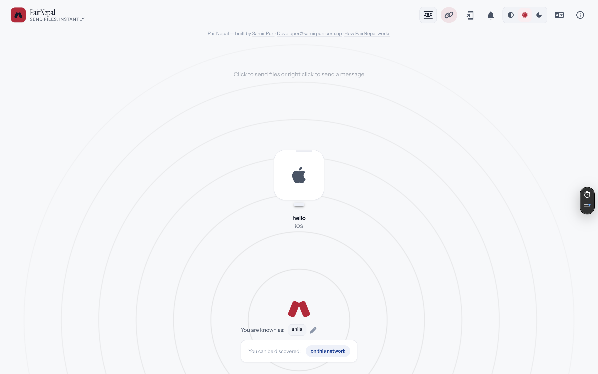
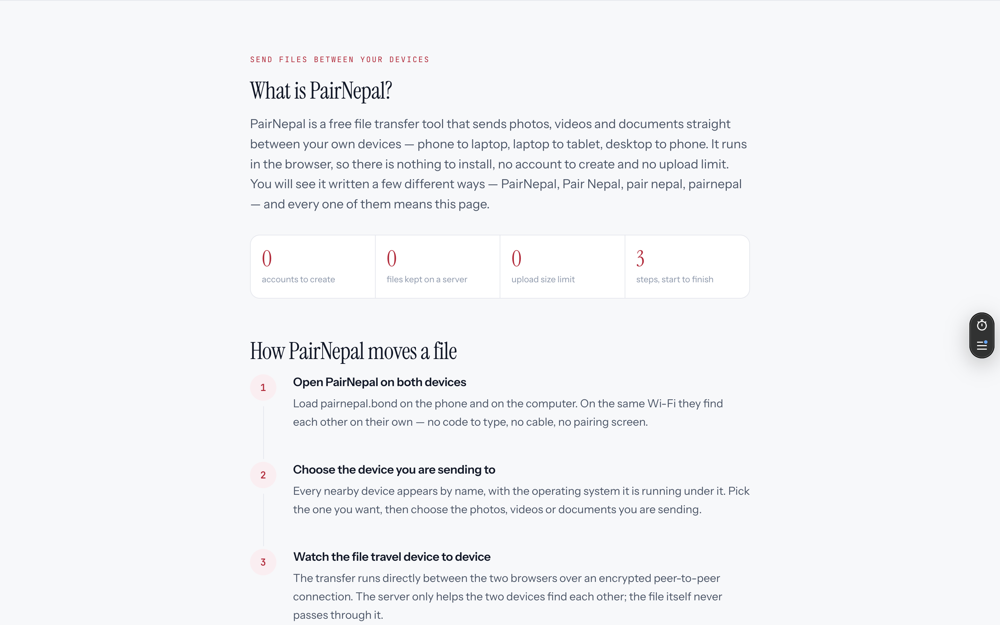
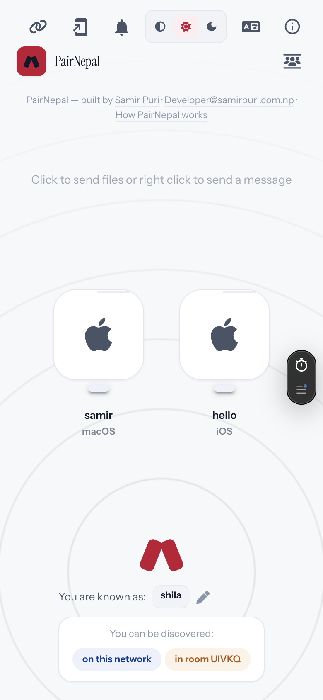
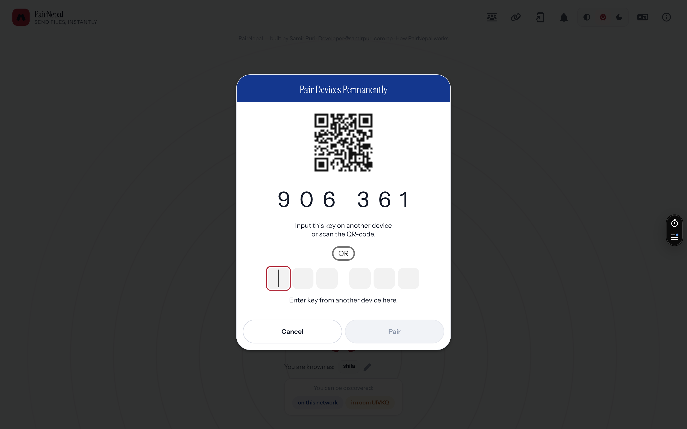

<p align="center">
  
</p>

<h1 align="center">PairNepal</h1>

<p align="center">
  Send files between your own devices, straight from the browser.<br>
  No account, no app, no cable. Designed and built in Nepal.
</p>

<p align="center">
  <a href="https://pairnepal.bond"><strong>pairnepal.bond</strong></a>
</p>

---

## Screenshots

<p align="center">
  
</p>

<p align="center"><sub><b>Landing page</b> &nbsp;·&nbsp; desktop, 1440 × 900</sub></p>

<br>

<p align="center">
  
</p>

<p align="center"><sub><b>How a file moves</b> &nbsp;·&nbsp; the three-step flow</sub></p>

<br>

<table align="center" border="0">
  <tr>
    <td align="center" valign="middle" width="260">
      
      <br><sub><b>Mobile</b> &nbsp;·&nbsp; 390 × 844</sub>
    </td>
    <td align="center" valign="middle">
      
      <br><sub><b>Pairing</b> &nbsp;·&nbsp; QR code and six-digit key</sub>
    </td>
  </tr>
</table>

<br>

All four were captured from the live site at [pairnepal.bond](https://pairnepal.bond).

---

## What this is

PairNepal moves a file from one of your devices to another in a few seconds. Open the site on
both, pair them, drop the file in — it lands on the other device.

The transfer runs **directly between the two devices over WebRTC**. Nothing is uploaded, nothing
is stored, and there is no account or sign-up anywhere in the flow. A small signalling service
exists for one reason only: so the two devices can find each other. Once they have, the server is
no longer involved.

It installs as a PWA, so on a phone it behaves like an app without going through a store.

## Design system

| | |
|---|---|
| Display type | Instrument Serif |
| UI type | Instrument Sans |
| Codes and keys | JetBrains Mono |
| Accent | crimson `#c11235` — every interactive affordance |
| Secondary | deep blue `#003893` — status chips only, never an action |

Light and dark themes are hand-tuned. Every token lives in `:root` in
`PairNepal-project/app/public/styles/brand.css`, so the whole identity can be retuned from one
file.

**Motion.** Only `transform` and `opacity` are animated, so the browser never has to re-layout.
Interaction feedback stays under 200 ms; entrance motion runs 260–620 ms. Looping animation pauses
when off-screen or when the tab is hidden, and `prefers-reduced-motion` resolves everything
straight to its end state. The brand ident is **live SVG rather than video** — theme-aware, crisp
at any size, about 2 KB inline, on a 3.6 s cycle.

**Sound.** Seven cues — `tick` · `click` · `found` · `notify` · `send` · `done` · `fault` — are
synthesised at runtime with the Web Audio API, so no audio files ship with the site. Sound is off
until the visitor opts in, and that choice persists.

---

## Repository layout

| Path | What it is |
|---|---|
| `PairNepal-project/app/` | The application |
| `PairNepal-project/app/public/` | The deployed site — this is what Vercel serves |
| `PairNepal-project/app/server/` | The signalling server (Express + `ws`) |
| `PairNepal-project/brand/` | The mark and every generated icon asset |
| `PairNepal-project/*.py` | The brand and asset generation scripts, re-runnable |
| `PairNepal-project/pairnepal-ad-ne.mp4` | The Nepali ad — 1080 × 1080, 21.6 s |
| `brand-eval/` | Brand mark evaluation renders from the options that were compared |
| `screenshots/` | The images used on this page |

---

## Architecture

```
browser  ──WebSocket──▶  signalling server (app/server/, Node + ws)
   │                          peer registry held in memory
   │
   └────WebRTC (data channel)────▶  the other device
             the file itself never touches the server
```

| Piece | Detail |
|---|---|
| Runtime | Node `>= 15` |
| Server | Express, `ws`, `ua-parser-js`, `unique-names-generator`, `express-rate-limit` |
| Entry point | `server/index.js` |
| Frontend | Static, no build step — plain HTML, CSS and JS under `app/public/` |
| Container | `app/Dockerfile`, plus the `docker-compose*.yml` files |

## Run it locally

```bash
cd PairNepal-project/app

npm ci
npm start            # node server/index.js
# or, with production flags:
npm run start:prod   # --rate-limit --auto-restart
```

With Docker:

```bash
cd PairNepal-project/app
docker build -t pairnepal .
docker run -p 3000:3000 pairnepal
```

Then open `http://localhost:3000`.

---

## Deployment

The **static site is live on Vercel** and the app shell loads, is fully restyled and installs as a
PWA.

**Peer discovery does not work on Vercel.** The signalling server has to stay resident and hold
the peer registry in memory; Vercel's own documentation notes that WebSocket connections on Vercel
Functions are pinned to a single instance and **close at maximum function duration**, which would
make peers keep dropping off each other's device lists. That is why `app/public/config.json` ships
with `"signalingServer": false`.

Three routes, in order of preference:

**A — Frontend on Vercel, signalling on a container host (recommended).** Keep the site where it
is and run the socket server as a second, small service:

```bash
cd PairNepal-project/app
docker build -t pairnepal .
docker run -p 3000:3000 pairnepal
```

Deploy that image to Render, Railway or Fly.io, then point the client's WebSocket URL at it.

**B — The whole app as one container.** `app/Dockerfile` works as it stands. Set `PORT`, and
`RTC_CONFIG` if you add a TURN server.

**C — Vercel Containers.** Vercel offers a Containers product, but long-lived sockets on it have
not been confirmed for this build. Check it against your plan before relying on it.

### Two more things worth knowing

- **Cross-network transfers need a TURN server.** Transfers on the same Wi-Fi work without one.
  `docker-compose-coturn.yml` is provided, and `rtc_config_example.json` shows the shape expected —
  `username` and `password` are placeholders to fill in with your own.
- **HTTPS matters.** WebRTC and service workers both require a secure context.

---

## Credits

**Built by Samir Puri** — [samirpuri.com.np](https://samirpuri.com.np) · Developer@samirpuri.com.np

The credit appears in four places in the app, including the About panel with a linked person icon.

## Licence

PairNepal is a derivative work of **PairDrop**
([schlagmichdoch/PairDrop](https://github.com/schlagmichdoch/PairDrop)), which is licensed
**GPL-3.0**. The licence text is at `PairNepal-project/app/LICENSE`, and the upstream copyright
notices are preserved as that licence requires.

Because this is a GPL-3.0 derivative, **any public deployment must remain GPL-3.0 and publish its
source.**
